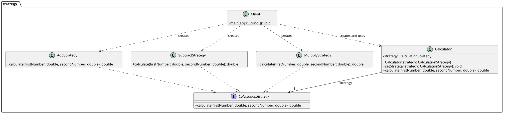

# Assignment 5: Strategy Pattern

## 1. Introduction

This project uses a calculator to demonstrate the Strategy pattern. Addition, subtraction, and multiplication are three algorithms for the same task: calculating a result from two numbers. The Client can choose an operation and change it while the program is running.

## 2. UML class diagram



## 3. Clean Code principles

### 3.1 Polymorphism replaces operation branches

A conditional version could select an operation by its name:

```java
if (operation.equals("add")) {
    return firstNumber + secondNumber;
} else if (operation.equals("subtract")) {
    return firstNumber - secondNumber;
}
```

In this project, `Calculator` delegates the work to the selected strategy:

```java
return strategy.calculate(firstNumber, secondNumber);
```

The Context does not check which operation it received.

### 3.2 Names describe the code's purpose

`CalculationStrategy`, `AddStrategy`, and `calculate` explain the role of each part. The interface gives all operations the same method:

```java
double calculate(double firstNumber, double secondNumber);
```

### 3.3 Each strategy has one responsibility

Each concrete strategy performs one calculation. For example, `AddStrategy` only adds the two values:

```java
public double calculate(double firstNumber, double secondNumber) {
    return firstNumber + secondNumber;
}
```

### 3.4 The Context depends on the interface

`Calculator` stores a `CalculationStrategy` reference. Its calculation method delegates through that interface, without using concrete strategy details:

```java
private CalculationStrategy strategy;

public double calculate(double firstNumber, double secondNumber) {
    return strategy.calculate(firstNumber, secondNumber);
}
```

### 3.5 New operations can be added separately

A division operation could be added in a new class that implements `CalculationStrategy`. The Client could pass that class to `Calculator`; the existing strategies and the Context would not need changes. For example, the new class would provide its own `calculate` implementation:

```java
public class DivisionStrategy implements CalculationStrategy {
    @Override
    public double calculate(double firstNumber, double secondNumber) {
        return firstNumber / secondNumber;
    }
}
```

This is an example of a possible extension; the project currently includes addition, subtraction, and multiplication.

## 4. Strategy and State

Strategy fits this calculator because the Client chooses which calculation algorithm to use. The algorithm can change while the calculator stays the same. State is used when an object's behavior depends on its current internal state and transitions between states. This calculator has no such lifecycle; its operation is selected for each calculation.

## 5. Conclusion

The Strategy pattern lets the calculator switch between three operations through one interface. The design adds one class for each operation, which keeps the calculations separate and makes new operations easier to add.

## 6. GitHub repository

[https://github.com/iuve1n/SDP_Assignment5](https://github.com/iuve1n/SDP_Assignment5)
